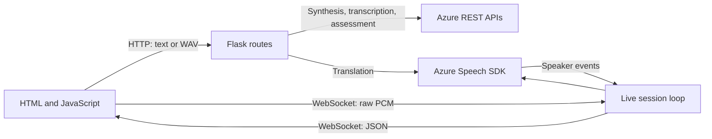

# Code walkthrough

This guide explains the project in execution order. A **block** is a function,
class, event handler, or related setup section. Repeated HTML, CSS rules, and
parameterized test cases are grouped by purpose.

All file links are relative to this document. See the [README](../README.md)
for setup and usage, and the [developer guide](DEVELOPMENT.md) for maintenance.

## 1. How the pieces connect

The browser handles user input, audio conversion, and display. Flask validates
requests and owns the credentials. Azure performs speech recognition,
synthesis, translation, assessment, and speaker labeling.

## 2. Flask application — [app.py](../app.py)

| Block | What it does |
| --- | --- |
| Module docstring and imports | Describe startup and import Flask, configuration loading, provider functions, and the live-route registrar. |
| `PROJECT_DIR`, `MAX_TEXT_LENGTH` | Locate configuration independently of the shell's directory and cap synthesis input at 3,000 characters. |
| `create_app(test_config)` | Build an independent Flask application. Tests use the same factory with configuration overrides. |
| `settings` merge | Combine repository `.env`, project `.env`, and environment variables in increasing precedence. |
| `app.config.update(...)` | Store the key and region on the server and limit HTTP bodies to 2 MiB. Support the existing key variable name as a fallback. |
| `if test_config` | Apply explicit test overrides after the normal configuration sources. |
| `configured()` | Check that a key exists and the region has an allowed shape. This does not test whether Azure accepts the credentials. |
| `same_origin()` | Before processing a request, reject POST submissions with a different Origin header. Requests without Origin remain permitted. |
| `secure_response(response)` | Add no-store, content-type protection, microphone permissions, and a content security policy to responses. |
| `speech_error(error)` | Convert a `SpeechError` into a JSON error response with its chosen HTTP status. |
| `http_error(error)` | Convert HTTP exceptions into JSON; give oversized uploads a specific 413 message. |
| `index()` | Render the main template with supported languages, voices, limits, and a configuration-ready boolean. Do not send the key. |
| `health()` | Return only the configuration-ready boolean for `/api/health`. |
| `text_to_speech()` input checks | Require a JSON object and nonempty text; check text length, XML-safe characters, the voice allowlist, and the numeric speed range. |
| `text_to_speech()` conversion | Require server configuration, call `synthesize`, and return WAV bytes with a download filename. |
| `speech_to_text()` | Read a multipart audio file and source locale, validate the WAV, call `transcribe`, and return recognized text. |
| `advanced_audio(languages, max_seconds)` | Share locale, upload, duration, and configuration validation between translation and assessment. Return validated bytes and the locale. |
| `speech_translation()` | Validate the target language, reject translation into the source language, and return `translate_speech` results as JSON. |
| `pronunciation_assessment()` | Check reference text length/content, enforce assessment-specific locales and the 30-second limit, and return scores and feedback. |
| `register_live_routes(app, configured)` call | Attach the live WebSocket endpoint to the same Flask application. |
| Factory return and `app = create_app()` | Return the configured application and expose a default instance for the Flask command. |
| `if __name__ == "__main__"` | Allow direct Python startup on loopback port 5000 with debugging disabled. |

Flask decorators such as `@app.post(...)` connect URL paths to the functions
immediately below them. Request hooks and error handlers run around those routes.

## 3. Shared REST operations — [speech.py](../speech.py)

| Block | What it does |
| --- | --- |
| Imports | Provide in-memory byte streams, WAV parsing, XML generation, and HTTP requests. |
| `MAX_AUDIO_SECONDS`, `LANGUAGES`, `VOICES` | Define recording limits and allowlists. Each voice includes its Azure ID, display label, and locale. |
| `SpeechError` and `__init__` | Carry a safe message plus an HTTP status so provider failures have one consistent representation. |
| `azure_request()` headers | Add the subscription key to the outgoing server-to-Azure request, replacing any supplied subscription header. |
| `azure_request()` network call | Perform a POST with connection/read timeouts. Convert network and provider errors into safe messages instead of forwarding diagnostics. |
| `synthesize()` XML construction | Find the selected voice's locale and build SSML with a voice and speed. XML serialization escapes user text. |
| `synthesize()` request/result | Request mono PCM WAV output from Azure; reject a response without a RIFF signature and otherwise return its bytes. |
| `validate_audio()` format checks | Open the actual WAV bytes and require one channel, two-byte samples, 16 kHz sampling, and uncompressed PCM. |
| `validate_audio()` frame checks | Reject empty audio, excessive duration, and truncated sample data. Turn parser failures into validation errors. |
| `transcribe()` request | Send the validated WAV to the short-audio endpoint with a source language and simple JSON output. |
| `transcribe()` result handling | Require a successful recognition result with nonempty text. Distinguish no-match/silence from malformed service replies. |

Status mapping is shared: authentication failures become 503, throttling 429,
timeouts 504, and other provider failures 502. Unrecognized speech uses 422.

## 4. Translation and assessment — [advanced_speech.py](../advanced_speech.py)

| Block | What it does |
| --- | --- |
| Imports and capability constants | Load the SDK and define translation targets, assessment locales, the 30-second assessment limit, and reference-text limit. |
| `pcm_frames(audio)` | Remove a validated WAV's container/header and return only sample bytes for an SDK push stream. |
| `sdk_error(event)` | Map an SDK cancellation code to a safe `SpeechError` without exposing its raw diagnostic text. |
| `translate_speech()` local state | Create a completion event, result/error lists, and references used for cleanup. |
| Translation configuration | Set the spoken locale and target language. Create a 16 kHz mono PCM stream and a translation recognizer. |
| Nested `recognized(event)` | Append each utterance that has both recognized text and a translation. This preserves multiple utterances in a clip. |
| Nested `cancelled(event)` | Save a sanitized error when appropriate and release the completion wait. |
| Callback registration | Connect recognition, cancellation, and session completion events to their handlers. |
| Recognition execution | Start continuous recognition, write raw samples, close input, and wait for completion for up to 85 seconds. |
| Translation result assembly | Reject errors or absent speech; join the utterances while also returning individual segments and language codes. |
| Translation `except` / `finally` | Sanitize unexpected SDK failures and attempt to close the stream and stop recognition on every exit path. |
| `score(value)` | Accept only finite numeric scores between 0 and 100 and round them. Return `None` for invalid values instead of inventing a score. |
| `assess_pronunciation()` parameters | Request hundred-mark, phoneme-level assessment with reference text and omission/insertion detection. |
| Assessment header/request | Base64-encode the settings as required by Azure and send them with the WAV to the detailed recognition endpoint. Base64 is encoding, not encryption. |
| Assessment response checks | Require successful recognition and select the first recognition hypothesis from `NBest`. Handle both flattened and nested score formats. |
| Aggregate score extraction | Normalize overall, accuracy, fluency, and completeness; reject a result missing valid aggregate scores. |
| Word/phoneme extraction | Return each word's accuracy, error label, and phoneme scores. Normalize unfamiliar error labels to `Other`. |
| Assessment return/error handling | Return the recognized text, reference, scores, and words, or a safe error for no speech or an unreadable response. |

## 5. Live speaker backend — [live_speech.py](../live_speech.py)

### `DiarizationSession`: wraps the Azure recognizer

| Block | What it does |
| --- | --- |
| Imports and constants | Provide JSON, queues, threading, timers, and WebSockets. Limit sessions to 300 seconds and calculate 32,000 PCM bytes per second. |
| `__init__(key, region, language)` | Create a bounded event queue, completion flag, raw audio stream, and conversation transcriber. Enable intermediate speaker labels and attach callbacks. |
| `emit(event)` | Add a browser-facing event without blocking the callback thread. Mark the session done if the bounded queue fills. |
| `result(event, kind)` | Convert a nonempty recognition result into a `partial` or `final` event with speaker label and timing in seconds. |
| `cancelled(event)` | Queue a sanitized error for an SDK failure and signal completion. |
| `start()` | Begin transcription and wait for the SDK startup operation. |
| `write(data)` | Feed already validated raw PCM bytes into the stream. |
| `close_input()` | Close the input once, allowing Azure to finalize the last utterance. |
| `stop()` | Close input and wait for the transcriber to stop. |

### `run_live_session`: owns the streaming loop

| Block | What it does |
| --- | --- |
| Session construction and `ready` | Create/start the provider session and tell the browser it may begin sending audio. |
| Timing and byte counters | Track session age, the last received audio, total samples received, and whether input is finishing. |
| Queue drain | Send SDK events from the request thread. SDK callback threads never write directly to the WebSocket. |
| Completion check | Leave the loop when the provider signals it is done. |
| Deadline checks | Finalize at five minutes, reject prolonged audio inactivity, and bound the wait for final results. |
| Binary-message branch | Require nonempty, whole PCM16 samples in chunks of at most 32,000 bytes. Enforce the independent total-audio limit before writing to Azure. |
| Text-message branch | Parse JSON and accept only the `stop` command. Close input and continue waiting for final results. |
| Final drain and `done` | Deliver remaining queued events before announcing completion. |
| Exception handlers | Treat disconnects as cleanup events and send safe messages for protocol or service failures. |
| `finally` | Attempt to stop the provider session even after a disconnect or error. |

### Route registration and connection admission

| Block | What it does |
| --- | --- |
| `register_live_routes(app, configured)` | Configure WebSocket limits/keepalive and create a two-slot, process-local semaphore. |
| Nested `live_diarization(ws)` origin/setup checks | Reject another origin and require configured server credentials. |
| Initial message check | Require a JSON `start` command with a supported language before creating a provider session. |
| Semaphore acquisition | Reject the connection if both live-session slots are occupied; otherwise enter `run_live_session`. |
| Route error handling / `finally` | Send safe rejection messages and always release an acquired slot. |

HTTP uploads include a WAV header; this WebSocket accepts **raw PCM without a
WAV header**. Confusing these formats sends container metadata as audio samples.

## 6. Shared browser navigation — [static/app.js](../static/app.js)

| Block | What it does |
| --- | --- |
| Strict mode and enclosing function | Keep variables out of the global scope and make accidental JavaScript mistakes easier to detect. |
| Tab lookup | Collect the buttons marked with `role="tab"`. |
| `activate(tab, moveFocus)` | Stop recording when leaving a speech panel, pause audio, show the selected panel, update accessibility attributes, and save the selected tab in the URL fragment. |
| Click handlers | Select the clicked tab. |
| Keyboard handler | Use arrow keys to cycle tabs and Home/End to jump to the first/last tab; move keyboard focus with the selection. |
| `activateFromHash()` | Select the tab named by the URL fragment, falling back to text to speech. |
| Hash-change and startup handlers | Support direct links and same-page changes such as `#live-diarization`. |

Custom `speech-studio:leave-speech` and `speech-studio:leave-live` events let
navigation request cleanup without directly owning microphone resources.

## 7. Synthesis browser controls — [static/text-to-speech.js](../static/text-to-speech.js)

| Block | What it does |
| --- | --- |
| DOM references and local state | Find controls, keep the current audio URL, and track whether a request is pending. Exit if the form is absent. |
| `setStatus(message, error)` | Display progress or an error using text content and a CSS class. |
| `updateCount()` | Count entered Unicode code points and refresh the character counter. |
| Text and rate input handlers | Refresh the character count and speed label as the user types or moves the slider. |
| Example and Clear handlers | Fill sample text or empty the editor, then restore focus and the counter. |
| Submit validation | Prevent duplicate submissions, require configured service access, and reject whitespace-only text. |
| Busy-state setup | Disable the generate button and display loading/progress indicators. |
| Fetch and timeout | POST text, voice, and rate as JSON to Flask; use `AbortController` to bound the browser wait. |
| Error-response branch | Prefer the API's safe JSON message and fall back to a readable generic error. |
| Success branch | Require nonempty audio, create a temporary blob URL, and connect it to the player and WAV download link. |
| `catch` / `finally` | Explain a failure or timeout and restore the controls regardless of the result. |
| `pagehide` and initialization | Release the temporary URL when leaving and initialize the text count on load. |

## 8. Upload, translation, and assessment controls — [static/speech-to-text.js](../static/speech-to-text.js)

### State and output helpers

| Block | What it does |
| --- | --- |
| DOM references | Connect the shared form to the file picker, recorder, language selectors, reference text, transcript, and feedback panels. |
| `modes` | Map each tool to its endpoint, button label, busy label, and result title. |
| Audio and operation state | Track the prepared WAV, preview/download URLs, duration, recorder, microphone stream, and request/recording flags. |
| `recordLimit()` | Choose 25 seconds for assessment recording and 55 seconds for the other short-recording tools. |
| `setStatus()` | Display progress or a safe error. |
| `updateControls()` | Lock conflicting controls during preparation, microphone permission requests, recording, or submission. Enable submission only when audio and configuration are ready. |
| `updateTranscript()` | Recount words and rebuild the text-download blob after edits. Enable copy/download only when text exists. |
| `clearTranscript()` | Clear text, original-speech display, and assessment feedback so old results are not shown for new input. |
| `clearAudio()` | Remove prepared audio and its preview URL, pause playback, and clear dependent results. |

### Audio preparation and file events

| Block | What it does |
| --- | --- |
| `encodeWav(samples)` header | Write the RIFF, WAVE, format, and data fields into a 44-byte WAV header. |
| `encodeWav(samples)` samples | Clamp floating-point audio to its valid range and encode signed 16-bit little-endian samples after the header. |
| `loadAudio(file, name)` validation | Reject empty/oversized files, unavailable browser audio support, decoding failures, and recordings beyond the current tool's duration limit. |
| `loadAudio()` normalization | Decode the source and render it through a one-channel, 16 kHz `OfflineAudioContext`. This converts supported source codecs and channel counts into one consistent format. |
| `loadAudio()` result/cleanup | Save the encoded WAV, show its preview and duration, close the temporary audio context, and restore controls. |
| File input `change` | Load the chosen file and reset the input so selecting the same file again still triggers a change. |
| Drag-over/leave/drop handlers | Highlight the drop target, prevent the browser's default file navigation, and accept one dropped file when controls are unlocked. |
| Remove handler | Clear the current recording and return focus to the file picker. |

The WAV byte rate is `16,000 samples/second × 2 bytes/sample = 32,000 bytes/second`.
This explains why a 60-second normalized recording fits below the server's 2 MiB
request limit, even when its original compressed file was a different size.

### Tool and language selection

| Block | What it does |
| --- | --- |
| `syncTarget()` | Choose another target when the selected translation language matches the source language. |
| `configureTask()` | Show the correct settings, labels, allowed assessment locales, and duration limit. Discard prepared audio if it is too long for the newly selected tool. |
| Task/target/reference/language handlers | Reconfigure the form or clear stale results when the meaning of the input changes. |
| Reference-example handler | Insert a short passage in the selected assessment language and focus the reading script. |
| `renderAssessment(data)` scores | Create four score cards from the service result. |
| `renderAssessment(data)` word feedback | Create expandable word and phoneme feedback, displaying scores and error labels as text rather than HTML. |

### Microphone recording

| Block | What it does |
| --- | --- |
| `releaseMic()` | Clear recording timers and stop every microphone track. |
| `finishRecording()` | Stop the recorder, if active, and release the microphone. |
| Record-button stop branch | If already recording, finish the current recording instead of starting another. |
| Record-button start branch | Check browser support, request microphone permission, and cancel safely if the user has already left the panel. |
| MIME-type selection | Pick a `MediaRecorder` format supported by the browser. The later decoding step converts it to the required WAV format. |
| `dataavailable` callback | Collect the encoded recording chunks supplied by the browser. |
| Recorder `error` callback | Mark the attempt as failed and release the microphone. |
| Recorder `stop` callback | Reset recording controls and pass the combined chunks through `loadAudio` for normalization and preview. |
| Timer block | Update elapsed time and automatically stop before the relevant upload-duration limit. |
| Permission/startup failure handling | Explain denied permission, a missing microphone, or another startup failure, then restore controls. |

### Submission, export, and cleanup

| Block | What it does |
| --- | --- |
| Form submit checks | Ignore conflicting operations and require a prepared recording and configured service. |
| Multipart body | Include the WAV and source locale, plus the target language or reference text required by the selected mode. |
| Fetch and timeout | Call the selected Flask endpoint and bound the browser wait. |
| Result dispatch | Show recognized text, or translated text alongside the original speech, or assessment scores and word feedback. |
| Request `catch` / `finally` | Display errors and restore controls even if the server cannot complete the operation. |
| Transcript input handler | Rebuild word count and export data when the user edits the result. |
| Copy handler | Copy text to the clipboard; if blocked, select it and explain the keyboard alternative. |
| Download handler | Prevent downloading when there is no text result. |
| Leave-panel event | Cancel a pending microphone request, stop active recording, and pause playback. |
| `pagehide` | Stop capture and revoke temporary audio/text URLs. |
| `pageshow` | Rebuild temporary URLs when the browser restores a cached page. |
| Final `configureTask()` call | Set the initial form state after all handlers are registered. |

## 9. Live microphone controls — [static/live-diarization.js](../static/live-diarization.js)

| Block | What it does |
| --- | --- |
| DOM references and state | Track the panel, session phase, microphone/audio objects, WebSocket, timers, transcript turns, and distinct known speaker labels. |
| `attempt` counter | Identify the current asynchronous attempt so late permission results or socket events cannot revive a cancelled session. |
| `setStatus()` | Display progress or errors. |
| `setPhase(value)` | Switch among `idle`, `starting`, `live`, and `finishing`, updating buttons, locks, and accessibility state. |
| `timestamp(seconds)` | Format a nonnegative offset as minutes and seconds. |
| `exportText()` | Produce one plain-text line per completed turn, including its timestamp and speaker label. |
| `updateDownload()` | Rebuild the transcript-download blob and enable export only when completed turns exist. |
| `addTurn(turn)` | Append a completed speaker turn, count known speakers, clear interim text, and refresh export data. |
| `releaseMic()` | Stop the microphone tracks, disconnect the input source, and clear the elapsed-time ticker. |
| `cleanup()` | Invalidate old callbacks, release audio/socket resources, remove interim text, and return the panel to idle. |
| `fail(message)` | Clean up a failed attempt while preserving completed transcript turns and showing an error. |
| `stop()` during startup | Cancel connection/permission work and release any acquired resources. |
| `stop()` during recording | Stop capture, flush the worklet's last partial chunk, send the JSON stop command, and wait briefly for final speaker results. |
| `begin()` support and permission checks | Require a compatible browser, stop any short recording, and obtain microphone access for the new attempt. |
| Audio setup in `begin()` | Load the PCM worklet and connect it to a microphone source. Its output to the speakers is silent; captured samples travel through messages. |
| WebSocket creation | Connect to the local app using `ws` or `wss`, matching the page's protocol. |
| Worklet message callback | Send PCM buffers only while the socket is open. Reject excessive socket backlog instead of silently dropping audio. |
| Socket `onopen` | Send the initial language/start command. |
| `ready` message branch | Reset the transcript for the newly connected session, connect capture, and start the five-minute timer. |
| `partial` message branch | Display the current in-progress speaker text without treating it as a completed turn. |
| `final` message branch | Add a completed turn to the transcript and export data. |
| `finishing` / `error` / `done` branches | Finish capture, show a safe failure, or clean up a completed session as directed by the server. |
| Connection error/close/deadline handlers | End broken or stalled sessions and keep already completed turns available. |
| Start and leave-panel handlers | Start/stop on button clicks and stop capture when navigating away. |
| Copy/download handlers | Export only completed speaker turns. |
| Page lifecycle handlers | Disconnect on departure, release temporary URLs, and rebuild the download URL on cached-page restoration. |

## 10. Audio processing thread — [static/pcm-worklet.js](../static/pcm-worklet.js)

| Block | What it does |
| --- | --- |
| `PcmCapture` class | Run microphone sample processing outside the main page's UI thread. |
| `constructor()` | Compute the input-to-16-kHz sampling ratio and initialize accumulators and an output sample buffer. |
| Port `flush` handler | Send any remaining output samples, then acknowledge that flushing finished. |
| `process(inputs)` channel loop | Average input channels to produce mono audio. |
| Resampling accumulator | Average sample contributions over each output interval. Retain fractional contributions across input blocks to keep timing consistent. |
| Chunk threshold | Send each 1,600-sample block: 100 milliseconds at 16 kHz. |
| `flush()` | Clamp/encode samples as PCM16, transfer the buffer to the page, and reset the sample buffer. |
| `return true` | Keep the worklet active for later audio blocks. |
| `registerProcessor(...)` | Expose the class under `pcm-capture`, the name used when the page creates its `AudioWorkletNode`. |

Unlike `encodeWav`, the worklet does not add a WAV header: the streaming SDK
expects only raw sample bytes.

## 11. Page templates

Jinja runs on the server. Expressions such as `{{ ... }}` insert values;
`` controls loops, conditions, and template inclusion.

| File/block | What it does |
| --- | --- |
| [index.html](../templates/index.html): head | Set the title/metadata and load local CSS and deferred JavaScript. Deferred scripts execute after the document is parsed. |
| Main layout and header | Provide navigation, the introduction, and the common visual frame. |
| Configuration notice | Show setup instructions when the server reports that configuration is incomplete. |
| Tab buttons and panels | Connect accessible tab controls to the three workspaces using IDs and ARIA attributes. |
| Template includes | Insert each workspace without duplicating the shared page frame. |
| [_text_to_speech.html](../templates/_text_to_speech.html): composer | Provide the text editor, example/clear controls, character count, voice selector, speed slider, and generate button. |
| Synthesis output panel | Reserve an empty state, player, and WAV download link for generated speech. |
| [_speech_to_text.html](../templates/_speech_to_text.html): input panel | Provide tool selection, file drop/picker, microphone controls, audio preview, and source-language selection. |
| Conditional tool settings | Provide translation targets or pronunciation reference text; JavaScript chooses which settings to show. |
| Speech-tool output panel | Reserve space for editable text, original speech, score cards, word feedback, and copy/download actions. |
| [_live_diarization.html](../templates/_live_diarization.html): controls | Provide conversation language, start/stop control, elapsed time, status, and speaker-label guidance. |
| Live output panel | Provide completed-turn and interim-text containers plus transcript export controls. |
| `data-*` attributes | Pass nonsecret readiness flags and limits from Flask into JavaScript. |
| Status regions and labels | Associate controls with readable labels and announce progress to assistive technology. |
| Workflow/privacy/footer markup | Explain the user steps and data handling without affecting conversion logic. |

## 12. Styling — [static/styles.css](../static/styles.css)

| Rule group | What it does |
| --- | --- |
| `:root` | Define the color palette, base font, and reusable design variables. |
| Global element rules | Normalize sizing, spacing, typography, buttons, links, SVGs, and focus states. |
| `[hidden]`, `.sr-only`, `.skip-link` | Respect hidden panels while keeping screen-reader labels and keyboard skip navigation available. |
| `.page-shell`, header, brand, introduction | Set the shared page width, identity, and introductory layout. |
| Configuration notice and status classes | Distinguish setup information, progress, and errors. |
| Mode/tab rules | Arrange navigation and visibly mark the selected tab. |
| `.studio-grid`, `.panel`, panel headings | Arrange the input/output cards and their shared borders, padding, and titles. |
| Editor, settings, select, slider rules | Size the text editor and configure consistent input controls. |
| Button/action rules | Distinguish primary/secondary actions and show disabled states. |
| Audio illustration, waveform, `@keyframes` | Draw decorative audio visuals and animate them during synthesis. These are not measured audio waveforms. |
| Player, empty-state, output-note rules | Lay out generated audio, placeholder content, and privacy text. |
| Upload/drop-zone and drag-state rules | Present the file target and indicate dragging or temporary lockout. |
| Recorder and source-preview rules | Arrange microphone controls, recording indicators, and uploaded-audio playback. |
| Transcript and export rules | Size editable output and align word counts, copy, and download actions. |
| Tool settings and source-transcript rules | Style mode-specific controls and show the original speech beside a translation result. |
| Score and word-feedback rules | Arrange assessment scores and highlight feedback with both text labels and color. |
| Live controls/illustration rules | Style the conversation controls and decorative two-speaker graphic. |
| Live lines, speaker labels, and interim-text rules | Separate completed turns and visually distinguish unfinished text. |
| Workflow and footer rules | Format the explanatory steps and closing page content. |
| Media queries | Adjust widths, grids, controls, and spacing for smaller screens; also respect reduced-motion preferences. |

## 13. Automated tests

Tests call Flask in-process and replace Azure HTTP/SDK behavior with mocks.
They do not need real credentials or provider traffic. Parameterization runs the
same test logic against multiple values, including invalid and boundary inputs.

### Shared testing building blocks

| Block | What it does |
| --- | --- |
| `wav_bytes(...)` helpers | Create deterministic silent WAV fixtures, including alternate formats and durations for validation tests. |
| `azure_response(...)`, `assessment_response(...)` | Build realistic success/failure bodies, including both assessment score formats. |
| POST-mocking fixtures | Replace provider HTTP requests with controllable responses and prevent real Azure calls. |
| App/client fixtures | Create isolated applications with fake credentials and in-process request clients. |
| `upload(...)` helpers | Assemble multipart requests so tests exercise the public route's parsing and validation. |
| `Signal`, `fake_translation`, nested `close()` | Simulate SDK callback registration, multiple translated utterances, completion, and cleanup without native recognition. |
| `Socket` fake | Supply scripted client messages and capture the server's decoded JSON events. |
| `Session` fake | Record supplied PCM, queue predictable speaker events, and expose whether cleanup ran. |
| `live_route`, `FakeSock`, nested route/register functions | Capture the WebSocket handler so origin and handshake checks can be tested in a Flask request context. |

### Test cases by file and purpose

| File | Code blocks covered |
| --- | --- |
| [test_app.py](../tests/test_app.py): synthesis success | Check playable/downloadable WAV output, voice and rate settings, and XML escaping. |
| Synthesis validation cases | Reject bad JSON, empty/oversized text, unsupported voices, invalid rates, and control characters before calling Azure. |
| Configuration and provider-failure cases | Check missing/invalid setup, authentication failures, throttling, network failures, timeouts, and non-audio responses. |
| Response/origin/size cases | Check credential non-disclosure, response headers, origin rejection/acceptance, and request-size enforcement. |
| [test_stt.py](../tests/test_stt.py): transcription success | Check outgoing audio, request headers/parameters, returned text, and supported/default locales. |
| WAV and upload validation cases | Reject malformed/truncated files, empty audio, wrong encoding, excessive duration, missing files, and oversized uploads; accept the duration boundary. |
| Recognition-result cases | Handle no-match/silence, empty text, malformed JSON, unexpected provider shapes, and HTTP/network failures safely. |
| Setup/origin/privacy cases | Prevent provider calls with missing setup, reject cross-origin uploads, and avoid exposing credentials. |
| [test_advanced_speech.py](../tests/test_advanced_speech.py): assessment parsing | Check aggregate, word, and phoneme feedback for flattened/nested replies and verify the encoded settings header. |
| Assessment validation/failure cases | Enforce reference text, locale, audio, and 30-second limits; reject invalid scores and unusable provider replies. |
| Translation route cases | Validate source/target/audio and pass the correct arguments to the translation helper. |
| Translation SDK cases | Preserve multiple utterances, strip the WAV header, and handle cancellation, no speech, SDK failure, and stream-close failure without leaking diagnostics. |
| Advanced-route admission cases | Require same-origin submissions and configured credentials. |
| [test_live_speech.py](../tests/test_live_speech.py): event sequence | Check that interim/final turns arrive before input finishes and the completed result is retained. |
| Streaming validation/cleanup cases | Reject bad PCM and commands; stop the provider after disconnects or errors. |
| SDK error mapping cases | Check safe statuses/messages for authentication, authorization, throttling, and connection failures. |
| WebSocket admission cases | Validate Origin, initial command, locale, and server-only credential forwarding. |
| Time and byte limit cases | Check inactivity cleanup, graceful finalization at the time limit, and independent audio-byte enforcement. |

## 14. Configuration and supporting files

| File/block | What it does |
| --- | --- |
| [pyproject.toml](../pyproject.toml): `[project]` | Declare project metadata, supported Python version, and runtime dependencies: Flask, dotenv loading, HTTP requests, Azure SDK, and Flask-Sock. |
| `[dependency-groups]` | Add pytest to the development environment. |
| `[tool.pytest.ini_options]` | Point test discovery at `tests` and make the local modules importable during tests. |
| [uv.lock](../uv.lock) | Record resolved dependency versions and artifacts for reproducible `uv sync` installations. It is generated rather than hand-maintained. |
| [.env.example](../.env.example) | Show configuration variable names with placeholders. The real `.env` stays outside version control. |
| [.style.yapf](../.style.yapf) | Select Google's Python formatting style and an 80-column target. |
| Repository [.gitignore](../../.gitignore) | Exclude credentials, Python environments/caches, and generated local test artifacts from commits. |
| [README.md](../README.md) | Explain setup, features, limits, test commands, and the external API. |
| [DEVELOPMENT.md](DEVELOPMENT.md) | Explain contracts, ownership, cleanup, and documentation/formatting checks for maintainers. |
| [WORKFLOW.md](../WORKFLOW.md) | Record the original feature branches, intentional merge conflicts, and resolution. |

## 15. Suggested reading order

1. Read `app.py` to see the request entry points and validation.
2. Read `speech.py`, then `advanced_speech.py`, for provider calls.
3. Read `live_speech.py` for streaming and resource ownership.
4. Read the templates alongside their matching browser scripts.
5. Read `pcm-worklet.js` to see how live audio samples are prepared.
6. Use the test files to find examples of success, invalid input, and failure
   handling without making Azure requests.
