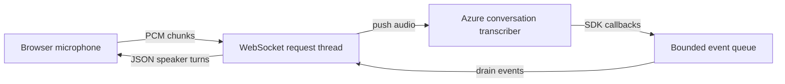

# Developer guide

Start with the [README](../README.md) for setup, supported languages, limits,
and the HTTP/WebSocket API. The [workflow record](../WORKFLOW.md) documents the
original branch-and-merge exercise.

## Module responsibilities

| Module | Responsibility | Caller expectations |
| --- | --- | --- |
| `app.py` | Application factory, HTTP input validation, rendering, error handlers | Use `create_app(test_config)` for an isolated application in tests. Handlers need a Flask request context. |
| `speech.py` | REST requests, synthesis, short transcription, WAV validation | Validate text/voice/rate or audio/locale before requesting Azure conversion. |
| `advanced_speech.py` | Continuous SDK translation and REST pronunciation assessment | Supply validated WAV bytes and operation-specific locales, reference text, and duration limits. |
| `live_speech.py` | Same-origin WebSocket, concurrency controls, conversation transcriber | Register once during application creation. Validate the start handshake before entering the stream loop. |

Public Python functions and classes document their parameters, return values,
expected errors, and relevant side effects in their docstrings. `SpeechError`
contains a browser-safe message and an HTTP status; avoid putting raw provider
diagnostics in either its message or client responses.

## Audio boundaries

Uploaded files are decoded and converted by `static/speech-to-text.js` before
submission. The HTTP routes independently call `speech.validate_audio` to check
the actual WAV encoding, duration, and frame data. Filenames and content-type
headers do not establish that an upload is valid audio.

REST requests include the WAV header. SDK push streams and the live WebSocket
accept raw PCM without that header. `advanced_speech.pcm_frames` removes the
header from an already validated WAV. `static/pcm-worklet.js` produces raw mono,
16-bit little-endian PCM at 16 kHz directly from the microphone.

For a new operation, perform its input validation in the Flask route before
starting a provider request. Do not assume that a browser's duration or language
checks also protect direct API callers.

## Live-session lifecycle



1. `register_live_routes` installs the WebSocket endpoint and a two-slot semaphore
   for that application registration. The semaphore is process-local.
2. The route checks the Origin header, server configuration, start message, and
   locale before acquiring a slot and calling `run_live_session`.
3. `DiarizationSession` creates its SDK stream and callbacks. Starting it begins
   recognition; SDK callback threads enqueue events rather than writing directly
   to the WebSocket.
4. The request thread drains events and validates incoming PCM chunks. It tracks
   elapsed time, total audio bytes, inactivity, and the finalization deadline.
5. A stop command or the session time limit closes audio input. The loop keeps
   delivering final results until Azure signals completion or finalization times
   out. A disconnected client triggers cleanup.
6. The loop attempts to stop the SDK session in `finally`, and the route releases
   its acquired semaphore slot in its own `finally` block.

`close_input` is idempotent. SDK lifecycle methods can fail; the outer loop owns
the sanitization of native failures. Once a WebSocket is upgraded, failures are
JSON `error` events rather than HTTP status responses. The exact wire protocol is
documented in the [README API section](../README.md#api).

## Configuration and credentials

Configuration precedence is repository `.env`, project `.env`, environment
variables, then explicit `create_app` overrides. Configuration readiness checks
presence and region syntax; it does not authenticate against Azure. Never print
the configuration mapping, subscription headers, or raw SDK diagnostics.

Tests use synthetic credentials and replace provider calls. When adding tests,
mock `speech.requests.post` for REST, the SDK constructors for translation, or
the live-session factory for streaming behavior. Route tests may patch the
function imported into `app`, such as `app.translate_speech`.

An isolated validation check can run without making an Azure request:

```python
from app import create_app

application = create_app({
    "TESTING": True,
    "AZURE_SPEECH_KEY": "",
    "AZURE_SPEECH_REGION": "",
})
with application.test_client() as client:
    response = client.post("/api/text-to-speech", json={"text": ""})
    assert response.status_code == 400
```

## Documentation and formatting

Follow the [Google Python Style Guide](https://google.github.io/styleguide/pyguide.html#38-comments-and-docstrings).
Use a short descriptive summary and add `Args:`, `Returns:`, `Raises:`, or
`Attributes:` sections when they clarify the contract. Include types in prose
when signatures lack annotations. Document side effects, resource ownership,
and caller validation requirements; keep implementation-only details in nearby
comments. Do not add test docstrings that merely repeat descriptive test names.

`.style.yapf` selects Google's formatter style with an 80-column target. From
`Week-5-task-1`, run these checks without adding tools to the project environment:

```bash
uv run pytest
uv run --with ruff ruff check --select D --config 'lint.pydocstyle.convention = "google"' app.py speech.py advanced_speech.py live_speech.py
uv run --with yapf yapf --quiet --recursive app.py speech.py advanced_speech.py live_speech.py tests
```

To apply formatting, replace `--quiet` with `--in-place`. Keep documentation
examples free of real credentials. Update the README when changing public
request/response fields, supported languages, recording limits, or setup steps.
