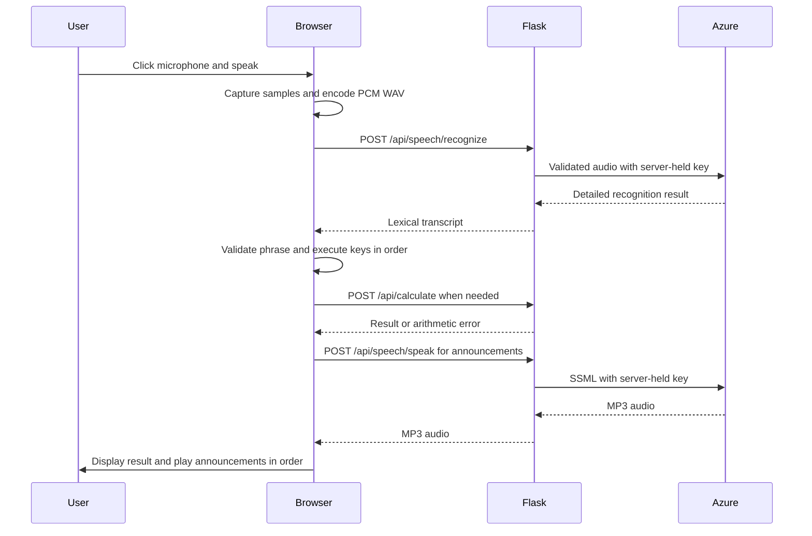

# Voice Calculator Documentation

This guide covers installation, configuration, usage, architecture, API contracts, troubleshooting, and verification. For an explanation of individual functions and code blocks, see [CODE_EXPLANATION.md](CODE_EXPLANATION.md).

## 1. Purpose and features

The calculator supports mouse, keyboard, and microphone input. Azure Speech converts a recorded command into text and generates spoken feedback for calculator actions. All three input methods share the same calculator behavior.

- Enter digits, decimal values, and the four arithmetic operations.
- Clear input, change its sign, calculate a percentage, or delete the last digit.
- Speak individual commands or a sequence such as “three plus five is.”
- Hear “three,” “plus,” “five,” and “is eight” when entering `3 + 5 =`.
- See recording status, recognized text, and error messages.

## 2. Installation and startup

### Requirements

- Python with support for the dependencies in `requirements.txt`.
- A browser supporting `getUserMedia`, `AudioContext`, `AudioWorkletNode`, JavaScript modules, and `AbortSignal.timeout`.
- A microphone and audio output device.
- Azure Speech credentials and an internet connection for speech features.
- Node.js with the built-in test runner for the optional JavaScript tests.

From the repository root:

```sh
cd Week-5-task-2
python3 -m venv .venv
source .venv/bin/activate
python3 -m pip install -r requirements.txt
python3 app.py
```

Open **http://127.0.0.1:5000/**. There is no frontend build step. Microphone capture requires localhost or HTTPS. `app.py` starts Flask's local development server with debug mode disabled.

### Azure configuration

The server searches for `.env` beginning in `Week-5-task-2` and then moving through its parent directories. It loads the first file found. Existing process environment variables take priority over values loaded from that file.

| Variable | Purpose |
| --- | --- |
| `AZURE_API_KEY_1` | Primary Azure Speech subscription key variable. |
| `AZURE_SPEECH_KEY` | Fallback used when `AZURE_API_KEY_1` is absent or empty. |
| `AZURE_SPEECH_REGION` | Region of the Speech resource; used to build the Azure service hostname. |

The repository's existing `.env` supplies the credentials. Do not paste their values into source code, documentation, browser scripts, or screenshots. `.env` is ignored by Git. Restart Flask after changing `.env` so it loads the updated configuration.

## 3. Using the calculator

### Voice commands

Click the microphone on the left, allow access if prompted, and speak. You can click it again to finish the recording manually.

| Button | Spoken command |
| --- | --- |
| `0` | Zero |
| `1` | One |
| `2` | Two |
| `3` | Three |
| `4` | Four |
| `5` | Five |
| `6` | Six |
| `7` | Seven |
| `8` | Eight |
| `9` | Nine |
| `.` | Point |
| `÷` | Over |
| `×` | Times |
| `+` | Plus |
| `−` | Minus |
| `=` | Is |
| `AC` | Clear |
| `+/−` | Change sign |
| `%` | Percent |
| `⌫` | Backspace |

Examples:

| Spoken sequence | Equivalent buttons | Result |
| --- | --- | --- |
| Three plus five is | `3 + 5 =` | `8` |
| Nine over three is | `9 ÷ 3 =` | `3` |
| One point five times two is | `1 . 5 × 2 =` | `3` |
| Four minus nine is | `4 − 9 =` | `-5` |

Recording automatically ends after approximately 1.4 seconds below the sound threshold once sound has been detected, or after a 10-second timer. This uses audio volume rather than language-aware speech detection. Background noise can affect when recording stops.

The whole transcript is checked before commands execute. An unknown word rejects the phrase without applying any commands. If an arithmetic error occurs during a valid sequence, earlier commands remain applied and the remaining commands stop.

### Mouse, keyboard, and feedback

| Keyboard input | Action |
| --- | --- |
| `0`–`9`, `.` | Enter digits or a decimal point. |
| `+`, `-`, `*`, `/` | Select an operation. |
| `Enter`, `=` | Calculate and announce the result. |
| `Escape` | Clear the calculator. |
| `Backspace` | Delete the last editable digit. |
| `%` | Divide the current value by 100. |
| `F9` | Change the current value's sign. |

Buttons and keyboard shortcuts produce the same spoken feedback as voice commands. Announcements play in order. Starting a microphone recording stops current playback and invalidates older queued announcements.

### Arithmetic behavior

The calculator evaluates operations in button order. For example, `2 + 3 × 4 =` produces `20`, because choosing multiplication first completes `2 + 3`. It does not parse expressions using mathematical operator precedence.

The display formats results to 12 significant digits. Input is limited to fewer than 14 existing characters excluding a minus sign before another digit can be appended; the decimal point counts toward that length. Number announcements read individual digits: `12.5` becomes “one two point five.” Percent always divides by 100; it is not a context-dependent percentage of another operand.

## 4. Project structure

```text
Week-5-task-2/
├── app.py                       Flask routes, configuration, and validation
├── speech.py                    Azure recognition and synthesis requests
├── custom_classes.py            Calculator arithmetic methods
├── main.py                      Original command-line demonstration
├── requirements.txt             Flask and python-dotenv dependencies
├── templates/index.html         Calculator page and accessibility markup
├── static/css/style.css         Appearance and responsive behavior
├── static/js/calculator.js       Calculator state and shared input handling
├── static/js/speech.js           Parsing, recording, WAV encoding, playback
├── static/js/recorder-worklet.js  Microphone sample capture
├── tests/test_speech.py          Python API and speech boundary tests
├── tests/commands.test.mjs       JavaScript parser and audio format tests
├── design/calculator.png         Original visual reference
├── README.md                    Quick start and documentation links
├── DOCUMENTATION.md             This guide
└── CODE_EXPLANATION.md           Code walkthrough
```

## 5. Architecture and data flow



Calculator state belongs to each browser page. Flask receives two operands per calculation and creates a `Calculator` instance for that request. The server does not maintain a shared calculator session.

Recordings and returned speech pass through memory; the application does not write them to disk. The browser keeps up to 64 decoded announcements in memory for reuse. Recognition and synthesis responses include `Cache-Control: no-store`. Azure still receives recordings and announcement text to provide the requested services; this describes application storage behavior, not Azure retention policies.

## 6. HTTP API

All routes are relative to the Flask server. Successful API requests use status `200`.

### `GET /`

Renders `templates/index.html` with links to the local CSS and JavaScript files.

### `POST /api/calculate`

Content type: `application/json`.

```json
{"operands": [3, 5], "operator": "+"}
```

Successful response:

```json
{"result": 8.0}
```

The operator must be one of `+`, `-`, `*`, `/`. Exactly two finite JSON numbers are required; booleans are rejected. Invalid input, division by zero, and non-finite results return `400` with an `error` message.

### `POST /api/speech/recognize`

Content type: `audio/wav`. The body is raw audio bytes, not a multipart upload or JSON object.

The server accepts nonempty, mono, 16 kHz, 16-bit PCM WAV audio lasting up to 12 seconds and checks that its declared frames are present. The browser's normal recording timer is 10 seconds; the server's acceptance limit is a separate validation boundary.

Successful response:

```json
{"text": "three plus five is"}
```

Recognition requests use English (`en-US`) and detailed results. The first candidate's `Lexical` field supplies words for the command parser.

### `POST /api/speech/speak`

Content type: `application/json`.

```json
{"text": "is eight"}
```

Returns MP3 bytes with content type `audio/mpeg`. The server accepts a nonblank string of up to 200 characters, restricted to letters, digits, spaces, and the punctuation/operator characters in `synthesize()`'s allowlist. It wraps escaped text in SSML, selects `en-US-JennyNeural`, and requests 24 kHz, 48 kbit/s, mono MP3 output.

### Errors and limits

| Status | Meaning in this application |
| --- | --- |
| `400` | Invalid arithmetic input, audio format, or announcement text. |
| `413` | Request exceeds Flask's global 512 KiB body limit. |
| `422` | Azure did not return a successful speech recognition match. |
| `502` | Azure HTTP/network failure, timeout, or malformed recognition response. |
| `503` | Missing key or missing/invalid region configuration. |

Handled arithmetic and speech errors return `{"error": "message"}`. The global `413` response uses Flask's default error page. Azure response bodies, request objects, and detailed upstream errors are not returned to the browser. Azure requests have a 20-second timeout; browser speech fetches use a 25-second abort timeout.

## 7. Troubleshooting

| Symptom | Action |
| --- | --- |
| Microphone access denied | Allow microphone access in browser site permissions, then retry. |
| Microphone support message | Open through localhost or HTTPS and use a browser with the required audio APIs. |
| Could not start microphone | Check the selected device and whether another application has exclusive access. |
| No speech recognized | Move closer to the microphone and speak an English command after clicking it. |
| Command not understood | Use the command table; ordinary conversational instructions are not supported. |
| Recording ends too early or late | Reduce background noise, avoid long pauses inside a sequence, or finish manually. |
| Speech unavailable / request failed | Check connectivity and the Azure resource's key, region, availability, and quota. |
| No spoken feedback | Check system volume/output and the voice status message. Arithmetic remains usable if speech fails. |
| Cannot divide by zero | Clear the calculator or begin a new number, then enter a valid operation. |

## 8. Verification

Run from `Week-5-task-2` with the Python environment activated:

```sh
python3 -m unittest discover -s tests -v
python3 -m py_compile app.py speech.py custom_classes.py main.py
python3 main.py
node --test tests/commands.test.mjs
```

The Python suite contains 10 tests covering arithmetic, speech validation, recognition responses, synthesis, missing configuration, and sanitized upstream failures. Azure calls in these tests are mocked; running them does not require a working key or consume Azure requests. The JavaScript suite contains five tests covering command mappings, phrase parsing, rejection, spoken numbers, and WAV encoding. The command-line demonstration prints `10.0`.

For a manual integration check, enter `3 + 5 =` and confirm both `8` and the requested announcements. Clear, click the microphone, and say “three plus five is”; verify the same result. Also check microphone permission denial, an unknown phrase, decimal arithmetic, and division by zero. These integration checks require actual browser audio support and working Azure credentials.
