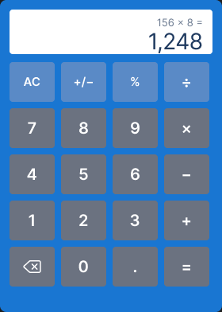

# Week 5 Task 2 — Voice calculator

Documentation:

- [Complete guide](DOCUMENTATION.md): setup, voice commands, architecture, API reference, troubleshooting, and verification.
- [Code block walkthrough](CODE_EXPLANATION.md): explanations of every application file and test block.

The voice calculator lives in `Week-5-task-2`. The original Week 4 calculator remains in `Week4/section_1`.

From the repository root, run:

```sh
cd Week-5-task-2
python3 -m pip install -r requirements.txt
python3 app.py
```

Open http://127.0.0.1:5000, allow microphone access, and click the microphone on the left before speaking. Recording finishes after a pause, when you click the microphone again, or after 10 seconds. Use localhost or HTTPS for browser microphone access.

The server loads the nearest `.env` in this folder or its parents. It uses `AZURE_API_KEY_1` (or `AZURE_SPEECH_KEY`) and `AZURE_SPEECH_REGION`. Environment variables take priority. Keep `.env` untracked. Azure keys stay on the Flask server; recordings are sent through Flask to Azure and are not saved by the application. Both recognition and spoken feedback require an internet connection and a working Azure Speech resource.

| Keys | Voice commands |
| --- | --- |
| 0–9 | Zero, One, Two, Three, Four, Five, Six, Seven, Eight, Nine |
| . ÷ × + − = | Point, Over, Times, Plus, Minus, Is |
| AC, +/−, %, ⌫ | Clear, Change sign, Percent, Backspace |

Speak one command per microphone click, or a sequence such as “three plus five is.” Unknown words reject the whole sequence without changing the calculator. Calculations follow button order, including chained operations.

Mouse and keyboard input also produce Azure spoken feedback in order. Pressing **3 → + → 5 → =** speaks **“three”, “plus”, “five”, “is eight.”** Audio for recently used announcements is reused in memory. The keyboard supports digits, operators, Enter, Escape, Backspace, %, and F9 (change sign).

Run the backend checks:

```sh
python3 -m unittest discover -s tests -v
python3 -m py_compile app.py speech.py custom_classes.py main.py
python3 main.py
```

If Node.js is installed, also run `node --test tests/commands.test.mjs` to check command parsing, spoken number formatting, and WAV encoding.

Speech uses Azure's [short audio recognition API](https://learn.microsoft.com/en-us/azure/ai-services/speech-service/rest-speech-to-text-short) and [text to speech API](https://learn.microsoft.com/en-us/azure/ai-services/speech-service/rest-text-to-speech). The browser records mono audio and converts it to 16 kHz PCM WAV before uploading.



[Original Figma design](https://www.figma.com/design/m8eMg1Fe6JROxkYHDPNS6X/calc?node-id=0-1&t=UUSyOwFrzBMGuIdO-1)
