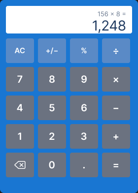

# Week 4 · Section 1 — Flask Web Calculator

A Flask calculator website styled after the Figma design export, routing arithmetic operations to `POST /api/calculate` via the `Calculator` class in [`custom_classes.py`](custom_classes.py) without using `eval()`.



[Source Figma design](https://www.figma.com/design/m8eMg1Fe6JROxkYHDPNS6X/calc?node-id=0-1&t=UUSyOwFrzBMGuIdO-1)

## Run Locally

Requires Python 3 and `Flask>=3.0,<4.0`:

```bash
cd Week4/section_1
python3 -m pip install -r requirements.txt
python3 app.py
```

Open <http://127.0.0.1:5000/>. To run the original CLI calculator check instead:

```bash
python3 main.py
```

## Project Layout

- [`app.py`](app.py) — Serves `GET /` and validates/dispatches arithmetic at `POST /api/calculate`.
- [`custom_classes.py`](custom_classes.py) — `Calculator` class (`add`, `subtract`, `multiply`, `divide` with zero-divisor `ValueError`).
- [`templates/index.html`](templates/index.html) — Calculator markup and keypad layout.
- [`static/css/style.css`](static/css/style.css) — Layout, blue card theme, and responsive styling.
- [`static/js/calculator.js`](static/js/calculator.js) — Keypad/keyboard input handling and `/api/calculate` fetch calls.
- [`PROMPTS.md`](PROMPTS.md) — Prompt history recorded for the assignment.

## API Contract (`POST /api/calculate`)

Request (`application/json`):

```json
{"operands": [10, 5], "operator": "+"}
```

- Supported `operator` values: `"+"`, `"-"`, `"*"`, `"/"`.
- `operands`: array of exactly two finite numbers (booleans rejected).
- Success (`200`): `{"result": 15.0}`.
- Validation or division-by-zero error (`400`): `{"error": "..."}`.
